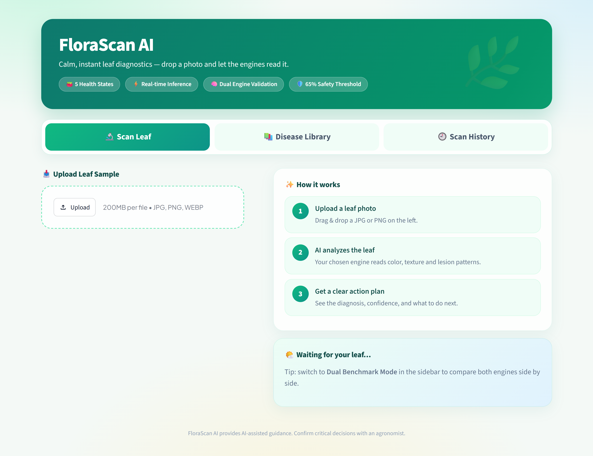
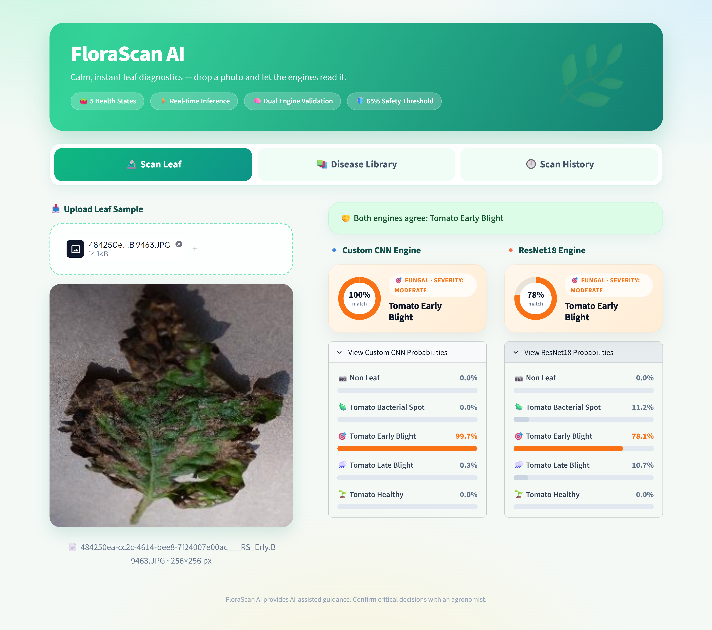
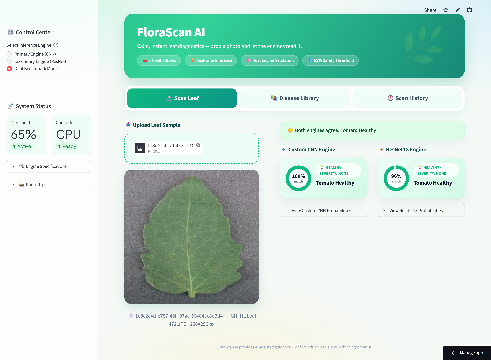
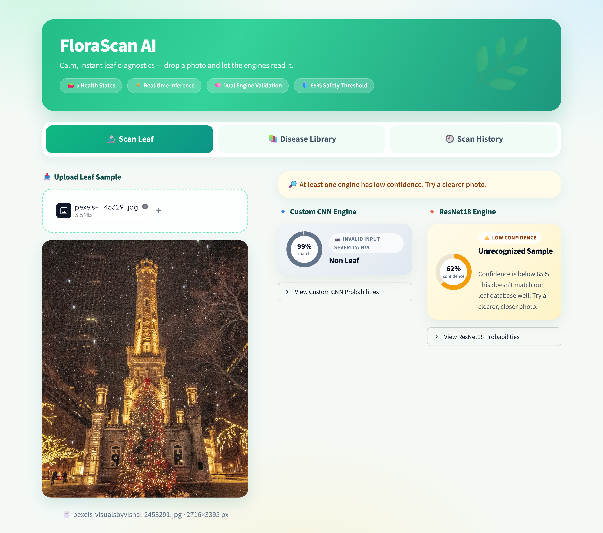
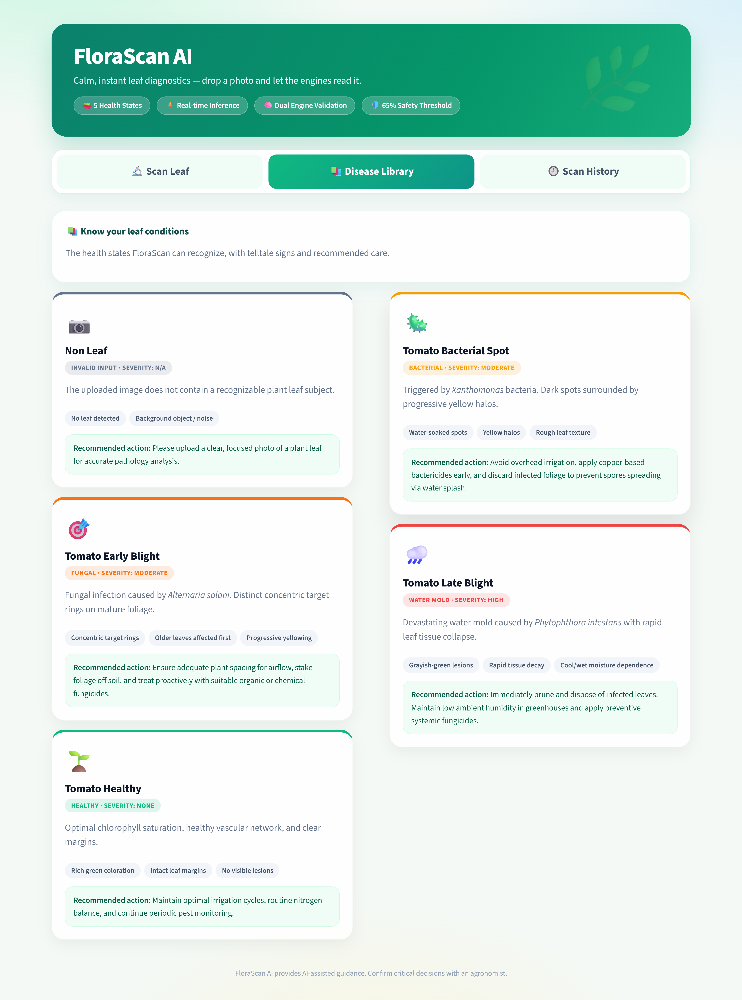
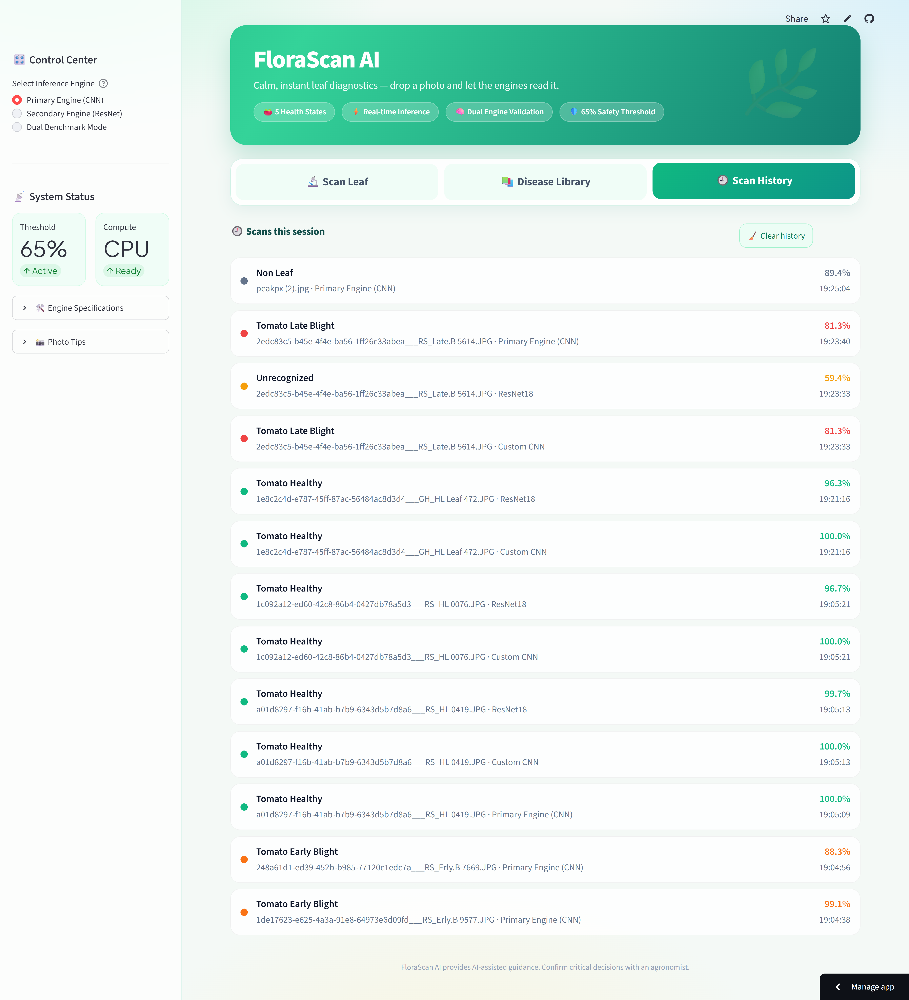
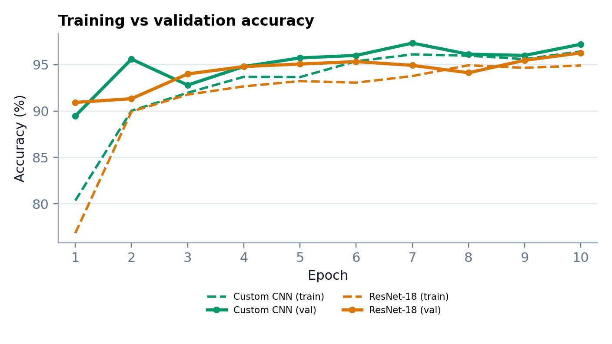

<div align="center">

# 🌿 FloraScan AI
### Smart Phytopathology System: Tomato Leaf Disease Diagnosis

[]()
[]()
[]()
[]()

*A dual-engine computer vision dashboard that classifies tomato leaf health in seconds, and refuses to guess when it is unsure.*

[**Project Website**](https://florascan-ai.vercel.app/) · [**Live Demo**](https://plant-disease-diagnostic-system.streamlit.app) · [**Project Report (PDF)**](docs/FloraScan_AI_Project_Report.pdf) · [**Presentation**](docs/FloraScan_AI_Presentation.pptx) · [**YouTube Video**](https://youtu.be/XTp5jaRU3Ws?si=b3SunZ4hsCavmjyc) · [**LinkedIn Post**](https://lnkd.in/p/dNEnaMfr) · [**Training Notebook**](Plant_Disease_Detection_V2.ipynb)

</div>

<br>

> **FloraScan AI** takes a photo of a single tomato leaf and diagnoses it as **Healthy**, **Bacterial Spot**, **Early Blight**, **Late Blight**, or **Not Leaf**, using two deep learning models that can be run individually or compared side by side.

---

## 🔗 Project Links

| Resource | Link |
|---|---|
| 🏠 Project website (all links) | [florascan-ai.vercel.app](https://florascan-ai.vercel.app/) |
| 🌐 Live web app | [plant-disease-diagnostic-system.streamlit.app](https://plant-disease-diagnostic-system.streamlit.app/) |
| 💻 GitHub repository | [asad-ali-sajjad/Plant-Disease-Diagnostic-System](https://github.com/asad-ali-sajjad/Plant-Disease-Diagnostic-System) |
| 🗂️ Dataset (Kaggle) | [PlantVillage](https://www.kaggle.com/datasets/emmarex/plantdisease) |
| 📄 Project report | [docs/FloraScan_AI_Project_Report.pdf](docs/FloraScan_AI_Project_Report.pdf) |
| 📊 Presentation | [docs/FloraScan_AI_Presentation.pptx](docs/FloraScan_AI_Presentation.pptx) |
| ▶️ YouTube video | [Watch the presentation and demo](https://youtu.be/XTp5jaRU3Ws?si=b3SunZ4hsCavmjyc) |
| 💼 LinkedIn post | [Project announcement](https://lnkd.in/p/dNEnaMfr) |
| 📓 Notebook | [Plant_Disease_Detection_V2.ipynb](Plant_Disease_Detection_V2.ipynb) ([open in Colab](https://colab.research.google.com/github/asad-ali-sajjad/Plant-Disease-Diagnostic-System/blob/main/Plant_Disease_Detection_V2.ipynb)) |
| 🧠 Model weights | [Hugging Face Hub](https://huggingface.co/asadalisajjad/FloraScan-AI-Weights) or this repository (Git LFS) |

---

## 📸 Screenshots

<table>
  <tr>
    <td width="50%"><br><sub><b>Home:</b> upload a leaf and pick an engine</sub></td>
    <td width="50%"><br><sub><b>Diagnosis:</b> verdict, confidence gauge, and action plan</sub></td>
  </tr>
  <tr>
    <td width="50%"><br><sub><b>Dual Benchmark:</b> both engines compared on one leaf</sub></td>
    <td width="50%"><br><sub><b>Safety threshold:</b> low confidence is flagged, not guessed</sub></td>
  </tr>
  <tr>
    <td width="50%"><br><sub><b>Disease Library:</b> signs, severity, and care</sub></td>
    <td width="50%"><br><sub><b>Scan History:</b> session log of every analysis</sub></td>
  </tr>
</table>

---

## 📊 Results at a Glance

Both models were trained for 10 epochs on the same data and evaluated once on a **held-out test set of 750 images**.

| Engine | Approach | Trainable params | Test accuracy | Correct |
|---|---|---|---|---|
| 🧠 **Custom 3-Block CNN** | Trained from scratch | ~51.5 M | **96.53%** | 724 / 750 |
| 🧠 **ResNet-18** | Transfer learning, frozen backbone | 2,565 | **94.13%** | 706 / 750 |

<div align="center">
  
</div>

> The custom CNN makes about 41% fewer mistakes (26 vs 44). ResNet-18 had its backbone frozen, so this compares a fully trained model with a feature-extraction baseline, not a fine-tuned ResNet.

---

## ✨ Key Features

* 🧠 **Multi-Engine Inference:** Switch between the Custom CNN, ResNet-18, or Dual Benchmark mode from the sidebar.
* ⚖️ **Dual Benchmark Mode:** Run both engines on the same leaf and see whether they agree, disagree, or are unsure.
* 🛡️ **Safety Threshold:** Predictions below **65%** confidence are shown as "Unrecognized" instead of being guessed.
* 🚫 **Out-of-Distribution Class:** A synthetic *Not Leaf* class helps reject clearly non-leaf uploads.
* 📊 **Visual Confidence Metrics:** Confidence gauge and probability bars across all five classes.
* 📚 **Disease Library:** Reference cards with signs, severity, and recommended care.
* 🕘 **Scan History:** Session log of every analysis, with one-click clear.
* ⬇️ **Downloadable Reports:** Export a text diagnosis report for any confident result.
* ⚡ **Fast & Robust:** Cached predictions, automatic reload when model files change, and friendly errors for bad images or missing checkpoints.
* 🧩 **Modular Design:** Built for easy retraining and multi-crop expansion *(currently active: tomato)*.

---

## 🗂️ Dataset

Built from the [PlantVillage](https://www.kaggle.com/datasets/emmarex/plantdisease) corpus (20,638 images, 15 categories) and balanced to **1,000 images per class**:

| Class | Images | Source |
|---|---|---|
| Tomato Healthy | 1,000 | PlantVillage |
| Tomato Bacterial Spot | 1,000 | PlantVillage |
| Tomato Early Blight | 1,000 | PlantVillage |
| Tomato Late Blight | 1,000 | PlantVillage |
| Not Leaf | 1,000 | Synthetic (noise, gradients, checkerboards, shapes) |

* **Split:** 70 / 15 / 15 → 3,500 train, 750 validation, 750 test (seeded random split, seed 42).
* **Training augmentation:** random horizontal flip and rotation up to 15°.
* **Input:** 224 × 224 RGB with ImageNet normalization.

---

## 🏗️ Model Architectures

**Custom 3-Block CNN (`CustomPlantCNN`)**
`Conv(3→32) → Conv(32→64) → Conv(64→128)`, each followed by BatchNorm, ReLU and 2×2 MaxPool, then Dropout(0.25) → `Linear(100,352→512)` + BatchNorm + ReLU + Dropout(0.25) → `Linear(512→5)`.

**ResNet-18 (transfer learning)**
ImageNet-pretrained backbone with all convolutional layers frozen and a new `Linear(512→5)` head.

**Training setup:** Adam (lr 0.001), cross-entropy loss, batch size 32, 10 epochs on an NVIDIA T4 GPU. The best checkpoint by validation accuracy is kept.

---

## 📂 Repository Structure

```text
FloraScan-AI/
├── 🖥️ app.py                          # Streamlit interface: sidebar, tabs, page flow
├── ⚙️ config.py                       # Classes, paths, threshold, labels, disease info
├── 🧠 model.py                        # Model building, loading, cached prediction
├── 🎨 ui.py                           # HTML components: result cards, probability bars, reports
├── 💅 styles.css                      # All visual styling
├── 📓 Plant_Disease_Detection_V2.ipynb # Data prep, training, and evaluation notebook
├── 🧠 best_custom_cnn_5class.pth      # Custom CNN weights (196 MB, Git LFS)
├── 🧠 best_resnet18_5class.pth        # ResNet-18 weights (42.7 MB, Git LFS)
├── 📁 .streamlit/
│   └── config.toml                    # Theme settings
├── 📁 .devcontainer/                  # Dev container setup
├── 📎 .gitattributes                  # Git LFS tracking rules for .pth files
├── 📜 LICENSE
├── 📁 assets/                         # Screenshots and figures used in this README
├── 📁 docs/                           # Project report (PDF) and presentation (PPTX)
├── 📦 requirements.txt                # Python dependencies
├── 🙈 .gitignore
└── 📖 README.md
```

---

## 🚀 Quick Start

```bash
# 1. Clone the repository (the model weights use Git LFS)
git lfs install
git clone https://github.com/asad-ali-sajjad/Plant-Disease-Diagnostic-System.git
cd Plant-Disease-Diagnostic-System

# 2. Install dependencies
pip install -r requirements.txt

# 3. Launch the dashboard
streamlit run app.py
```

> Requires **Streamlit 1.27 or newer**. Both `.pth` files (`best_custom_cnn_5class.pth` and `best_resnet18_5class.pth`) must sit next to `app.py`.
>
> **Weights not downloading?** Without Git LFS, Git fetches tiny pointer files instead of the real weights and the app cannot load them. Run `git lfs pull`, or download both files from the [Hugging Face mirror](https://huggingface.co/asadalisajjad/FloraScan-AI-Weights) and place them next to `app.py`.

---

## 🔄 Retraining & Customization

Most changes only touch `config.py`:

| What changed | What to edit |
|---|---|
| Same classes, new weights | Nothing. Replace the `.pth` file and the app reloads it automatically. |
| Classes added, removed, or renamed | `CLASS_NAMES` in `config.py`. Optionally add entries to `UI_META` and `DIAGNOSTIC_GUIDE`. |
| Different architecture | The matching `build_model_1` / `build_model_2` in `model.py`. |
| Different input size or normalization | `INPUT_SIZE`, `NORM_MEAN`, `NORM_STD` in `config.py`. |
| Different confidence threshold | `CONFIDENCE_THRESHOLD` in `config.py`. |
| Different crop | `CLASS_NAMES`, `CROP_EMOJI`, and text in `config.py`. |

> ⚠️ **`CLASS_NAMES` must match your training label order exactly.** This project's `ImageFolder` order is `Not_Leaf, Tomato_Bacterial_spot, Tomato_Early_blight, Tomato_Late_blight, Tomato_healthy`. If you retrain, run `print(train_dataset.classes)` and use that order. A wrong order raises no error but gives wrong diagnoses.

---

## ⚠️ Limitations

* PlantVillage images are lab-style; accuracy on real field photos may be lower.
* The synthetic *Not Leaf* class is simple, so cluttered real-world non-leaf photos may still get a confident leaf label.
* Evaluation uses one random split and overall accuracy; no confusion matrix or per-class metrics yet.
* Covers one crop and three diseases.

## 🔭 Future Work

Fine-tuned ResNet comparison · per-class metrics and cross-validation · field images and realistic negatives · multi-crop expansion (potato, pepper, corn, apple, grape) · ONNX / mobile export · GPS-tagged outbreak mapping.

---

## 🎓 Academic Context

Developed as the **Deep Learning** semester project (BSCS-7A, 7th Semester) by **Asad Ali Sajjad** (SU92-BSCSM-F23-167), under the supervision of **Dr. Munir Ahmad**.

## ⚖️ Disclaimer

FloraScan AI provides AI-assisted guidance only. Confirm critical decisions with a qualified agronomist.
